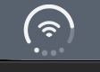

<p align="center"></p>

# Status Ring

Class: public · Mac · AI: no · rung 2

**Battery, network and volume in one tiny menu bar glyph, because your menu bar is not a parking lot.**

[](LICENSE)  [](https://github.com/krosta-codes/status-ring/releases)

## Why this exists

My menu bar had a battery icon, a Wi-Fi icon, a volume icon and a system monitor, all fighting the notch for space. [DuoBar](https://github.com/Mikeli7666/DuoBar) by Mike Li had the right idea: pack the essentials into one glyph. Status Ring is my fork of it, tuned to how I read it at a glance, with CPU and memory folded in so I could delete my separate system monitor app.

## What it does

- **Ring:** battery level. Charging adds a bolt and turns green; full on the adapter is a closed green ring.
- **Center:** Wi-Fi, Ethernet or offline.
- **Four dots:** output volume.
- **Desktop Macs** (no battery) get the Adaptive Ring, which shows system load instead.
- **Click it** for a popover: battery details, network speed, nearby Wi-Fi, audio output and input switching, volume and brightness, CPU, memory and storage tiles. Cards can be reordered.
- **App Volume:** per-app volume (0 to 100 %, no boost), mute and per-app output device, remembered per bundle ID. Open it from the chevron on the Volume card. Needs macOS 14.2 or later.
- While the popover is open, the volume keys move its slider instead of popping the system overlay (needs Accessibility).

## Install

| You need | Why |
|---|---|
| macOS 13 or newer | SwiftUI APIs the app uses |
| Xcode Command Line Tools | builds the app; no full Xcode needed |

1. Clone and run the installer:

   ```
   git clone https://github.com/krosta-codes/status-ring.git ~/Projects/apps/status-ring
   ~/Projects/apps/status-ring/install.sh
   ```

   It checks your Mac, builds with `swiftc`, installs to `/Applications` and starts the app.

2. Popover › Settings › **Launch Status Ring at login**.

3. Optional, saves re-granting Location and Bluetooth after every update: create a local signing certificate once. Keychain Access › Certificate Assistant › Create a Certificate…, name `<Your name> Local Signing`, Identity Type "Self-Signed Root", Certificate Type "Code Signing". Run `install.sh` again.

Permissions it may ask for: **Location** (macOS only reveals the Wi-Fi network name to apps with it), **Bluetooth** (recognises Bluetooth audio devices), **Accessibility** (volume keys, optional), **System Audio Recording** (per-app volume, optional; asked on the first per-app change, lives in Privacy & Security › Screen & System Audio Recording).

## Updates

Status Ring checks this repo's releases 30 s after start and once a day. A new version puts **Update to vX.Y.Z** in the popover footer; it pulls your clone, rebuilds and restarts. Settings › General has **Check now** and the daily-check toggle.

The check is one request to the GitHub API and nothing else. Turn it off in Settings, or `defaults write com.jurek.statusring updateCheck -bool false`.

## Build by hand

```
./build-local.sh               # build, install to /Applications, restart
./build-local.sh --no-install  # build only, into build/StatusRing.app
```

The macOS 27 SDK needs Xcode's SwiftUI macros, so the script picks the newest 26.x (or older) SDK from the Command Line Tools. Override with `SDK=/path/to/MacOSX.sdk`. Version lives in `VERSION`.

## Tests

```
./run-tests.sh                 # whole XCTest suite
./run-tests.sh AppAudioTests   # one test class
```

Needs Xcode in `/Applications` (the build itself does not). The script sets `DEVELOPER_DIR`, so `xcode-select` can stay on the Command Line Tools.

## Privacy

| What | Where it goes |
|---|---|
| Battery, network, audio, system stats | read locally, never sent anywhere |
| Wi-Fi name (Location permission) | used for display only |
| App audio | processed live on this Mac, never recorded or sent |
| Update check | one request to api.github.com, no data about you |

## Known quirks

- Without Location permission the Wi-Fi name shows as hidden. That's macOS, not us. Promise.
- The source folders are still called `DuoBar`. Renaming 100 files buys nothing and makes merging upstream fixes harder.
- Built without Xcode, so the asset catalog is precompiled in `assets/`. Change the icon there, not in `Assets.xcassets`.
- App Volume needs macOS 14.2 or later. On older systems the section is simply not shown.
- With TascamVolume running and the TASCAM US-4x4 as default output, TascamVolume applies the per-app levels (handoff). An app routed explicitly to the US-4x4 is also scaled by TascamVolume's master keys.
- Builds without the local signing certificate (other users' updates) ask for the System Audio Recording permission again after each update.
- Per-app settings live in the `appAudio` defaults key, a dictionary keyed by bundle ID: `{ volume = 0.3; muted = 0; outputUID = "<device UID>"; }`. `outputUID` is optional (absent means follow the default output); an entry at 100 %, unmuted, without `outputUID` is removed.
- Diagnostics: `StatusRing --list-audio-apps` (hidden flag) lists the apps currently playing audio. For the debug log run `defaults write com.jurek.statusring appAudioDebug -bool true`, then `log stream --predicate 'subsystem == "com.jurek.statusring"'`.

## Credits

Status Ring is a fork of [DuoBar](https://github.com/Mikeli7666/DuoBar) by Mike Li and contributors, released under the MIT License. Their copyright notice is kept in [LICENSE](LICENSE). All the hard Core Audio, IOKit and CoreWLAN work is theirs; the ring tweaks, system stats and the no-Xcode build are mine.

---

Built by [Jurek Krosta](https://jurekkrosta.com) ("AI Slop - aber richtig").
Need this built for your shop or team? [Contact](https://jurekkrosta.com).
